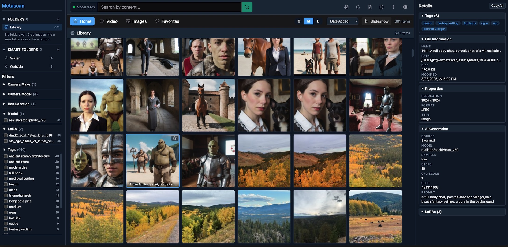
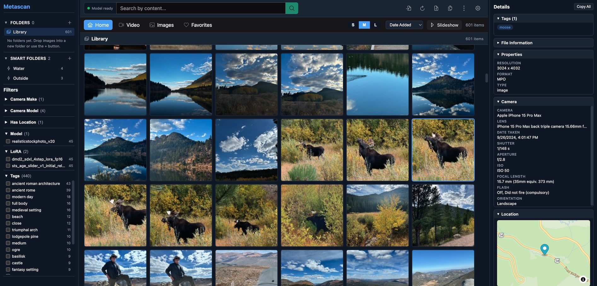
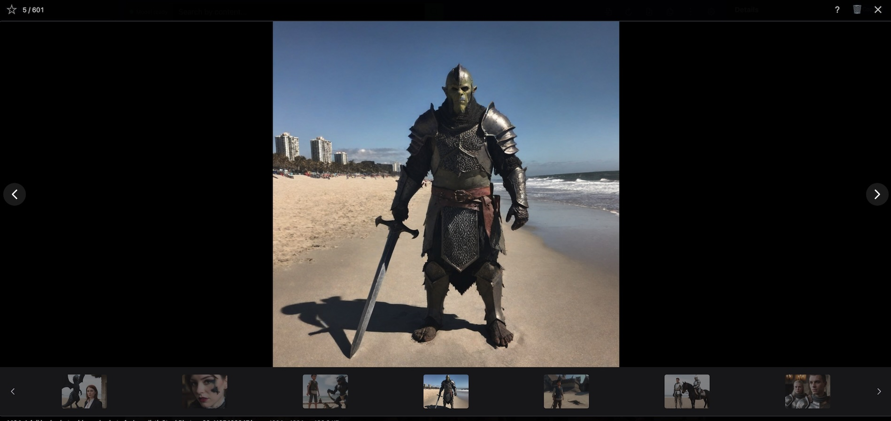
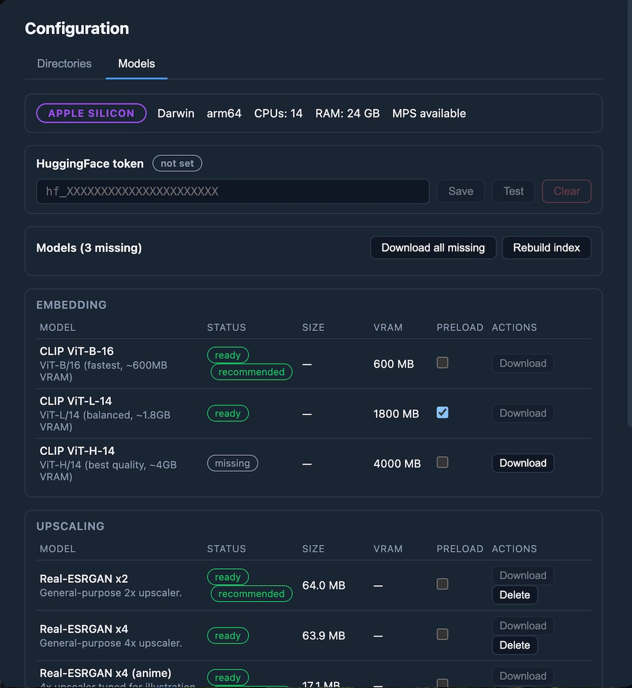
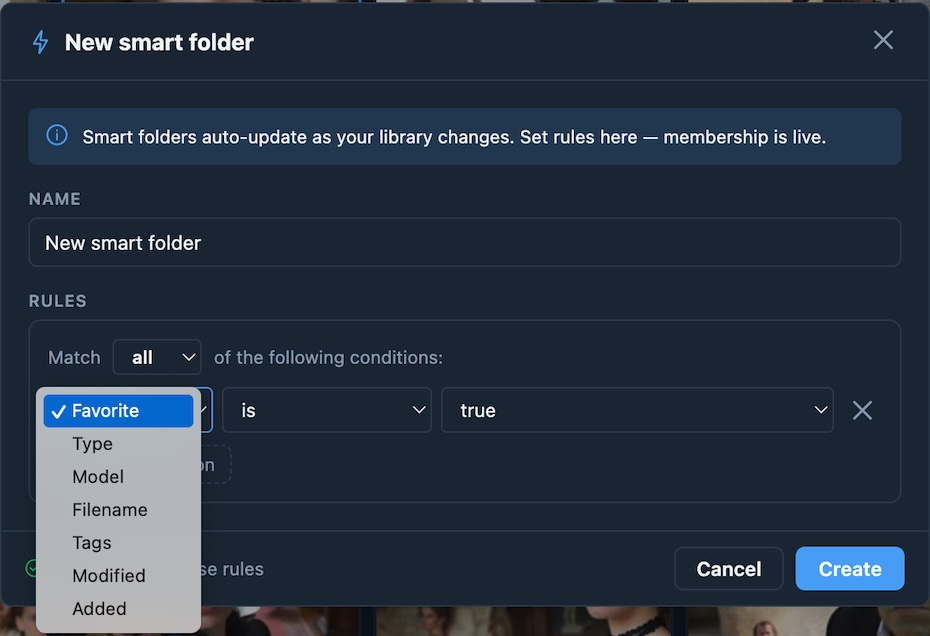

# Metascan

**AI media browser with metadata extraction, similarity search, and web-based remote access**

# Unreleased

### Pass / Fail Grades

Favorites and training signals are now two separate marks:

- **★ Favorite** is back to "I want to look at this again": filters, smart folders and the tile star use it, and nothing learns from it
- **✓ Pass / ✗ Fail grades** (P / X in the viewer, reasons on 1–6) are the only thing the taste scorer, prompt-writer training and the writer scorecard learn from; viewing an image teaches nothing
- Grades show as a small ✓ / ✗ badge on library, Text to Image and Image to Video tiles, and smart folders get a **Grade** rule
- Deleting a graded image keeps what it taught: its thumbnail, prompt and brief are kept for training, across CLIP model changes too
- The training sections moved to a new **Config → Training** tab
- **One-time upgrade:** the first start converts your ratings (favorites become ★ + ✓, old rejects ✗) after backing up the database to `data/metascan.db.pre-v6-<date>-<time>.bak`; if that fails the server refuses to start and changes nothing. See [Upgrading an existing library](docs/features.md#upgrading-an-existing-library-one-time) for restoring the backup and for the Ctrl-C a refused start needs under `run_server.py`

### Search as a Filter

Content search moved from a separate results view into the left filter panel, where it composes with everything else:

- **SEARCH section** in the filter panel — CLIP text-to-image search, tag search (AND of multiple tags with autocomplete chips), and an adjustable score-threshold slider
- **Search results are a filter layer** — they intersect with the Video/Images/Favorites presets, the standard filters, and the selected folder instead of replacing the grid
- **Unbounded results** — everything above the score threshold is shown, not a fixed top-100
- **Relevance sort** — auto-selected when a search runs, restoring your previous sort when cleared
- **Find Similar** (right-click a thumbnail) uses the same filter model, with its own 0–1 threshold scale

# Latest Release v0.14

## Changes since v0.3.0

**New features**
- **Generation through ComfyUI:** connect to ComfyUI to create text-to-image and image-to-video batches, with reusable workflow presets.
- **Storyboards:** plan shots and beats, then generate them in a dedicated workspace.
- **Upscaling through ComfyUI:** ready-made SeedVR2 and Remacri workflows, with originals kept so you can compare or revert.
- **Taste learning:** ✓ pass / ✗ fail grades, categories and a personal score that learns what you like.
- **Prompt-writer training:** train LoRA adapters from your grades and edits, then compare them with blind scorecards.
- **AI tagging and chat:** Qwen vision-model tagging, plus a chat window that replaces the Prompt Playground.

**Library and everyday use**
- **Always-on import:** new files appear on their own, moved files keep their ratings, and Windows gets real-time file detection.
- **Background activity panel:** see, pause and stop background work in one place. Library hygiene now runs when the app is idle.
- **Library transfer:** export ratings, categories, folders and saved prompts, and import them on another machine.
- **Mobile and viewing:** a responsive mobile layout and a slideshow.

**Windows**
- **Native support:** Metascan now runs natively on Windows, with a guide for moving from WSL2.
- **Setup wizard:** a new installer handles prerequisites, GPU setup, a tray launcher, updates and uninstall.

**Changes when upgrading**
- **Ratings:** favorites and rejects are migrated automatically to ★ and ✓ / ✗ grades, and the database is backed up first.
- **Import button:** it's gone, and Full clean & rescan has moved to Config → Maintenance.
- **Upscaling:** ComfyUI is now required, as Metascan no longer includes its own upscaler.

## Overview

Metascan is an open-source browser for AI-generated images and videos that doubles as a general-purpose photo viewer. It automatically extracts metadata from generators like ComfyUI, SwarmUI, and Fooocus — prompts, models, samplers, LoRAs — alongside the camera EXIF and GPS coordinates that come with regular photos, so a single library can mix synthetic and real media without losing context. The built-in viewer handles full-screen images with zoom and pan, plays video with speed and frame-step controls, and runs an ordered or shuffled slideshow with fade transitions.

A FastAPI backend handles scanning, the SQLite database, CLIP/FAISS similarity search, duplicate detection, and driving ComfyUI for generation and upscaling, while a Vue 3 SPA provides the UI. The two halves talk over REST and a multiplexed WebSocket, which means the heavy GPU work can stay on a desktop tower while you browse from any laptop, tablet, or phone on the network. The stack is cross-platform — Linux, macOS (Apple Silicon and Intel), and Windows are first-class, and a hardware probe at startup auto-tunes which CLIP model is recommended for your machine.

The library organizes itself two ways. Static folders are manually curated collections you fill by right-clicking items; smart folders are saved rule sets — over tags, model, source, dates, favorite status, ✓ / ✗ grade — that re-resolve as content changes, so a folder like "high-step photoreal generations from last month" stays current without maintenance. Folder mutations broadcast over the WebSocket so multiple browser tabs stay in sync.

  
  

<em>Supports AI Generate and Photos</em>

## Screenshots

  

<em>Media viewer</em>

  
  

<em>Complete Model Management and Smart Folders</em>

## Documentation

Detailed documentation lives in [`docs/`](docs/):

- **[Features](docs/features.md)** — full feature list, including media browsing, viewer, rating (★ favorites and ✓ / ✗ grades, and the one-time upgrade), slideshow, similarity search, duplicates, upscaling, filtering, folders, and keyboard shortcuts
- **[Tech Stack](docs/tech-stack.md)** — backend, frontend, AI/media processing, infrastructure, and dev tooling
- **[First-Time Setup](docs/first_time_setup.md)** — step-by-step, per-platform install of Python, Node, FFmpeg, virtualenv, and all dependencies
- **[Installation](docs/installation.md)** — prerequisites, end-user setup, contributor setup, environment variables
- **[Moving a Library](docs/library-transfer.md)** — export your favorites, grades, T2I / I2V settings and training data, and import them on another PC
- **[Configuration](docs/configuration.md)** — `config.json` reference, including the `similarity`, `ui`, `models`, `comfy`, `i2v`, `t2i`, and `upscale` sections
- **[Image-to-Video Workflow Setup](docs/i2v-workflow-setup.md)** — step-by-step ComfyUI build and registration for the MiniMax H3 turbo and high-quality presets
- **[Image-to-Video cadence templates](docs/i2v-templates.md)** — the JSON découpage-template format that fixes an i2v clip's shot structure
- **[Background activity](docs/background-activity.md)** — the activity pill and grid: what runs in the background, held vs paused vs stopped, and what pause and stop do for each process
- **[Upscaling](docs/upscaling.md)** — upscale images and videos with ComfyUI workflows: registering a workflow, comparing results, accept and revert, and the Original folder
- **[Text to Image](docs/t2i.md)** — the Text to Image dialog: caption sources, character and wildcard files, prompt styles per model, server-side batches, and workflow requirements
- **[API Reference](docs/api-reference.md)** — REST endpoints, WebSocket envelope, error shapes
- **[Architecture](docs/architecture.md)** — client–server layout, database schema, backend/frontend layouts, key design decisions
- **[Windows Installer](docs/windows-installer.md)** — install, update and remove Metascan on Windows with a setup wizard, and how to build the installer
- **[Moving to Windows](docs/windows-migration.md)** — move a WSL2 install, library included, to native Windows for real-time file detection
- **[Prompt-Writer Training](docs/writer-training.md)** — train a LoRA adapter for the prompt writer from your ✓ / ✗ grades and edits: Windows/WSL2 setup, base weights, the GPU lock, serving, and the blind scorecard
- **[Hardware Detection](docs/hardware-detection.md)** — what gets probed, tier classification, per-model gates, auto-warnings
- **[Building llama-server](docs/build-llama-server.md)** — when and how to build llama.cpp from source for accelerators upstream doesn't ship (notably Linux + CUDA)
- **[Developer Guidelines](docs/developer-guidelines.md)** — build commands, code style, testing, CI

Contributors should also read [`CONTRIBUTING.md`](CONTRIBUTING.md). The canonical, exhaustive rule set for the codebase lives in [`CLAUDE.md`](CLAUDE.md).

## License

This project is licensed under the Apache License 2.0 - see the [LICENSE](LICENSE) file for details.

## Acknowledgments

- Thanks to the creators of ComfyUI, SwarmUI, and Fooocus for their amazing AI generation tools
- OpenCLIP for CLIP model implementations
- Built with Vue 3 and FastAPI for modern web architecture
- Powered by SQLite for efficient local data storage
- Uses FFMPEG for robust video processing capabilities
